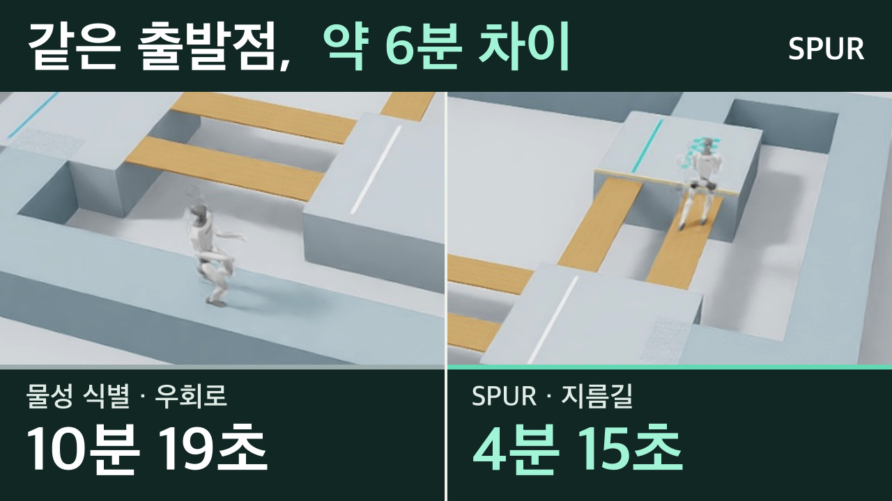

# SPUR

**Selective Quadruped Probing of Uncertain Routes for Biped Shortcut Selection**  
이족로봇의 지름길 선택을 위한 사족로봇의 선택적 접촉 탐색 기법  


Go2가 판자를 처음 눌렀을 때 G1이 건널 수 있을지 불확실하면, 지금 우회하는 편이 나을까, 조금 더 눌러보는 편이 나을까? SPUR는 G1의 주행 결과로 이 선택을 학습한다. 추가 접촉으로 위험한 판을 걸러내거나 포기했던 지름길을 되찾을 가능성을 경로 비용으로 환산해, Go2가 멈출지, 하중을 뺄지, 더 유지할지 고른다. G1은 탐색이 끝난 판 상태에서 선택한 경로를 걷는다.

[](SPUR-demo.mp4)

[대표 영상 보기 · MP4, 45초](SPUR-demo.mp4) · [1080p 영상 다운로드](https://github.com/Dabin0312/SPUR/raw/refs/heads/main/SPUR-demo.mp4)

영상은 Isaac Sim의 같은 코스에서 두 가지 선택을 보여준다. 첫 장면은 탐색 없이 진입한 G1과 Go2의 관측으로 길을 고른 G1을, 두 번째 장면은 물성 식별이 선택한 우회로와 SPUR가 회복한 지름길을 비교한다.

**논문 결과.** 회복 헤드를 끄면 G1이 우회했던 코스 중, 헤드를 켰을 때 G1이 지름길로 완주한 코스는 본시험 **10/10**, 독립시험 **3/6**이었다.

## 구현

| 파일 | 역할 |
| --- | --- |
| [planner.py](planner.py) | 두 갈림길에서 탐색할 판을 고르고, 관측을 재사용해 G1의 경로를 선택한다. |
| [observer.py](observer.py) | Go2 발의 수직 하중과 상대 변위 시계열을 접촉 인코더 또는 물성 식별기에 입력한다. |
| [value_model.py](value_model.py) · [policy.py](policy.py) | 지지 상실 발견과 지름길 회복을 각각 예측하고 추가 관측의 기대 이득을 접촉 시간과 비교한다. |
| [train.py](train.py) | 같은 계열의 물성을 함께 분할해 통과 점수, 사건 라벨, 두 헤드와 보정값을 학습한다. |

### 사용

Python 3.10 또는 3.11을 사용한다.

```sh
python -m pip install -r requirements.txt
python train.py --help
```

`planner.select_route`는 학습된 `Policy(policy_checkpoint, encoder_checkpoint)`, 다섯 경로의 예상 시간(초), Go2의 초기 접촉과 연장 동작을 실행하는 두 콜백을 받는다. 출력은 G1의 경로와 각 판에서 선택한 탐색 동작이다. 두 글자로 된 지름길 코드는 첫째·둘째 갈림길의 좌우 선택을 나타내고, `BB`는 외곽 우회로다.

학습에는 사전학습된 접촉 인코더와 개발 주행 기록이 필요하다. `train.py`는 개발판 폴더 `D00`–`D15`에서 Go2의 `short`·`release`·`hold` 관측과 G1 직행 결과를 읽는다. 공개 범위는 방법 구현과 시연 영상이며, 시뮬레이터 장면·원시 로그·학습 가중치는 별도 입력이다.
