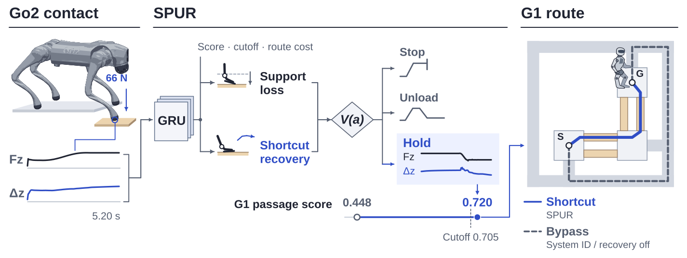

# SPUR

**Cooperative Quadruped–Biped Route Planning via Dual-Head Contact Probing**

이중 헤드 접촉 탐색을 통한 사족·이족 협력 경로 계획

겉보기에는 같은 두 판자 중 어느 쪽이 이족로봇 G1의 체중을 버틸까? 사족로봇 Go2가 앞발로 한 번 눌러도 판단하기 어려울 수 있다. SPUR는 **Go2가 어느 판을 조금 더 짚으면 G1의 경로 선택이 달라질지** 학습한다. Go2는 그 판에서 하중을 유지하거나 빼면서 반응을 확인하고, G1은 갱신된 관측으로 지름길과 우회로 중 하나를 골라 걷는다.

[실행 영상 · 45초](SPUR-demo.mp4) · [실험 결과](#실험-결과) · [코드 사용법](#코드-사용법)



## 어떤 판을 더 짚는가?

Go2는 세 발로 선 채 한 앞발로 판을 누른다. 첫 가압까지 측정한 **수직 하중과 다른 세 발에 대한 앞발의 상대 변위·속도**를 GRU로 인코딩한다. 두 헤드는 시뮬레이션에서 G1이 각 판을 건넜는지, 지지를 잃었는지를 학습에 사용해 추가 접촉이 첫 판단을 어떻게 바꿀지 예측한다.

| 첫 가압 뒤의 판단 | 추가 접촉으로 확인할 사건 |
| --- | --- |
| 이 판을 경로에 **포함** | **지지 상실 탐지** — G1이 지지를 잃을 판을 추가 관측으로 걸러낼 수 있는가? |
| 이 판을 경로에서 **제외** | **지름길 회복** — G1이 실제로 건널 수 있는 판을 추가 관측으로 다시 채택할 수 있는가? |

플래너는 경로를 올바르게 바꿀 이득, 잘못 바꿀 손실, 추가 접촉에 드는 시간을 초 단위로 비교해 **Stop**(첫 가압에서 종료), **Unload**(바로 제하), **Hold**(유지 후 제하) 중 하나를 고른다. 새 관측에도 같은 채택 기준을 적용한다. 두 갈림길에서 하나씩 건널 판을 찾으면 G1은 그 지름길로, 찾지 못하면 고정 우회로로 간다.

## 실험 결과

Isaac Lab에서 외형이 같은 판자 네 장을 두 갈림길에 배치했다. 본시험은 물성 구성 3개 × 좌우 배치 4개, 독립시험은 새 물성 세트 6개 × 배치 2개다. 각 코스에서 G1은 Go2 탐색 직후의 판 상태에서 같은 보행 제어기로 출발했다.

| 논문 Table 1 | 본시험 · 12코스 | 독립시험 · 12코스 |
| --- | ---: | ---: |
| 물성 식별(System ID)로 첫 시도 도착 | 12/12 | 10/12 |
| SPUR에서 회복 헤드를 끄고 첫 시도 도착 | 11/12 | 11/12 |
| **SPUR로 첫 시도 도착** | **12/12** | **12/12** |
| **회복 헤드를 끄면 우회한 코스 중, 켜면 지름길로 완주** | **10/10** | **3/6** |

**시간은 어느 경로를 골랐는지에 따라 달라졌다.** 세 방법이 모두 완주한 독립시험 10코스에서, 물성 식별 대비 SPUR의 **Go2 접촉 + G1 보행** 시간은 평균 31.54초 짧았고 중앙값은 4.80초 길었다. 평균 절감은 긴 우회를 피한 한 코스에서 나온 363.37초 차이로 설명된다. 시간 집계에서는 Go2의 탐색 지점 간 이동과 실패 비용을 제외했다.

### 영상에서 볼 두 장면

[](SPUR-demo.mp4)

1. **본시험 · 탐색 없음 vs. SPUR** — 둘째 갈림길에서 탐색 없이 진입한 G1은 왼쪽 판에서 지지를 잃는다. SPUR는 오른쪽 판을 골라 도착한다.
2. **독립시험 · 물성 식별 vs. SPUR** — 물성 식별은 첫 가압에서 멈추고 G1을 외곽길로 보낸다. SPUR는 하중을 유지했다가 뺀 뒤 판을 다시 채택한다. 두 방법 모두 도착하고, 지름길을 택한 G1의 보행 시간이 줄어든다.

[1080p 영상 다운로드](https://github.com/Dabin0312/SPUR/raw/refs/heads/main/SPUR-demo.mp4)

## 코드 사용법

공개 저장소에는 접촉 인코더 구조, 두 헤드의 학습 코드, 경로 플래너와 시연 영상이 들어 있다. 논문 실험을 다시 실행하려면 별도로 개발 주행 로그, 사전학습된 인코더 가중치, 시뮬레이터 장면 및 연결 코드가 필요하다.

Python 3.10 또는 3.11에서 다음 명령으로 의존성을 설치하고 학습 입력을 확인할 수 있다.

```sh
python -m pip install -r requirements.txt
python train.py --help
```

| 진입점 | 입력과 출력 |
| --- | --- |
| [train.py](train.py) | 개발판 `D00`–`D15`의 Go2 관측·G1 결과와 인코더 가중치를 받아, 물성 그룹을 나눠 학습·보정한 정책을 `model.pt`로 저장한다. |
| [observer.py](observer.py) | Go2의 `time`, `feet`, `foot_fz`에서 관측 시점까지의 접촉 표현 또는 물성 추정값을 계산한다. |
| [value_model.py](value_model.py) · [policy.py](policy.py) | 지지 상실 탐지와 지름길 회복을 예측하고, 경로 이득과 추가 접촉 시간을 비교해 탐색 동작을 고른다. |
| [planner.select_route](planner.py) | 정책, 다섯 경로의 예상 시간, 초기·연장 접촉을 수행하는 콜백 두 개를 받아 선택 경로와 각 판에서 수행한 동작과 통과 판정을 반환한다. `LR`은 첫 갈림길 왼쪽·둘째 갈림길 오른쪽, `BB`는 외곽 우회로다. |
